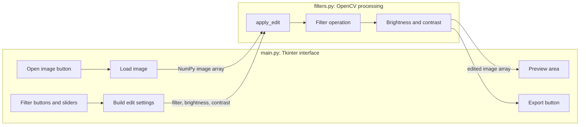
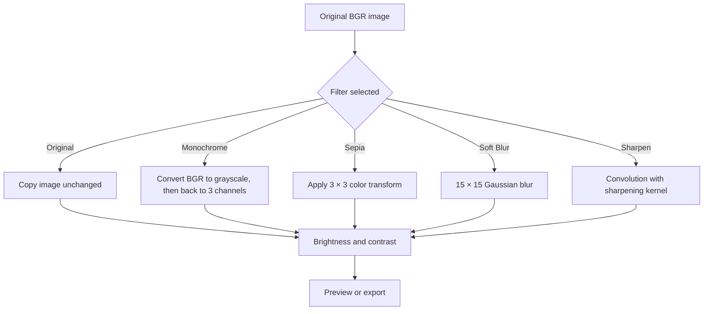

# Pixel Studio

Pixel Studio is a small desktop photo editor built with **Python**, **Tkinter**, and **OpenCV**. It demonstrates how a graphical interface can send user-selected settings to image-processing functions, preview the result, and export it.

## Features

- Open PNG, JPG, JPEG, WEBP, or BMP images
- Preview the edited image in the application
- Apply Original, Monochrome, Sepia, Soft Blur, or Sharpen
- Adjust brightness and contrast
- Reset the controls to their starting values
- Export as PNG, JPEG, or WEBP

## How the application is organized



The main responsibilities are:

| File or function | Responsibility |
| --- | --- |
| `main.py` → `PixelStudio` | Creates the window and connects controls to actions. |
| `open_image()` | Opens the file dialog and decodes the selected file into an OpenCV image. |
| `_add_slider()` / `_slider_changed()` | Creates brightness and contrast controls and refreshes the preview as they move. |
| `render_preview()` | Calls `apply_edit()`, converts OpenCV's BGR colors to RGB, and displays the result with Pillow. |
| `reset_edits()` | Restores the Original filter and zeroes both adjustment controls. |
| `save_image()` | Applies the current settings and writes the result in the chosen format. |
| `image_editor/filters.py` → `apply_edit()` | Applies one filter, then brightness and contrast, and returns a new image array. |

## What happens to an image

OpenCV loads a color image as a NumPy array with channel order **BGR**: blue, green, red. Each pixel channel is usually an integer from 0 to 255. The selected filter is applied first; brightness and contrast are applied afterward.



`apply_edit()` starts with `image.copy()`. This keeps the loaded original available, so selecting a different filter or pressing Reset starts from the same source rather than repeatedly degrading the last preview.

## The filter math

The formulas below describe the operations in `image_editor/filters.py`. For spatial filters, $I(i,j)$ means the pixel at row $i$, column $j$; for color filters, a pixel is represented by its channel values.

### Monochrome (grayscale)

OpenCV converts each BGR pixel to a luminance-like gray value, then the app expands that one-channel image back to three identical channels so the rest of the preview and export pipeline can keep using a color image.

A common approximation for the gray value is:

$$
Y \approx 0.114B + 0.587G + 0.299R
$$

Here $B$, $G$, and $R$ are the blue, green, and red channel intensities. The code calls `cv2.cvtColor(..., cv2.COLOR_BGR2GRAY)` for this conversion; OpenCV performs the conversion internally.

### Sepia

The code applies a matrix transform to each pixel in OpenCV's BGR channel order. Each output channel is limited to the 0–255 range:

$$
B' = \min(255, \max(0,\;0.272B + 0.534G + 0.131R))
$$

$$
G' = \min(255, \max(0,\;0.349B + 0.686G + 0.168R))
$$

$$
R' = \min(255, \max(0,\;0.393B + 0.769G + 0.189R))
$$

`cv2.transform()` performs the matrix multiplication. `np.clip()` limits values to 0–255, and conversion to `uint8` stores the result as standard 8-bit image channels.

### Soft blur

The blur uses `cv2.GaussianBlur(result, (15, 15), 0)`. For each output pixel, a weighted neighborhood average is taken. Nearby pixels receive larger weights than pixels farther away:

$$
I_{\mathrm{blur}}(i,j)=\sum_{u=-7}^{7}\sum_{v=-7}^{7}G(u,v)\,I(i-u,j-v)
$$

where $G$ is a 15-by-15 Gaussian kernel whose weights sum to 1. The `0` sigma argument asks OpenCV to choose the Gaussian spread from the kernel size. Averaging nearby pixels softens fine details and edges.

### Sharpen

The sharpen filter uses this 3-by-3 kernel:

K = `[[0, -1, 0], [-1, 5, -1], [0, -1, 0]]`

For each pixel, the center is multiplied by 5 and its four direct neighbors are subtracted:

$$
I_{\mathrm{sharp}}(i,j)=5I(i,j)-I(i-1,j)-I(i+1,j)-I(i,j-1)-I(i,j+1)
$$

This emphasizes changes between a pixel and its neighbors, which makes edges appear sharper. `cv2.filter2D()` applies this convolution separately across the image channels.

### Brightness and contrast

After the selected filter, the code calculates the contrast multiplier $\alpha$ and brightness offset $\beta$:

$$
\alpha=1+\frac{c}{100},\qquad \beta=b
$$

Then each channel is transformed as:

$$
I_{\mathrm{out}}=\min(255,\max(0,|\alpha I_{\mathrm{filtered}}+\beta|))
$$

Here $b$ is the brightness slider value and $c$ is the contrast slider value; both range from $-100$ to $100$. At $b=c=0$, values stay unchanged. Positive brightness adds a constant to channel values. Contrast scales channel values around zero in this implementation: increasing $c$ increases the multiplier, while decreasing it lowers the multiplier. `cv2.convertScaleAbs()` applies the scale and offset, takes the absolute value, rounds, and saturates values to the 0–255 range.

## Run Pixel Studio

You need Python 3.10 or newer. Tkinter is included with most Python installations. On some Linux distributions, install the system `python3-tk` package if Tkinter is missing.

Create a virtual environment from the project directory:

```bash
python -m venv .venv
```

Activate it in Windows PowerShell:

```powershell
.venv\Scripts\Activate.ps1
```

Or on macOS/Linux:

```bash
source .venv/bin/activate
```

Install the Python packages and start the app:

```bash
python -m pip install -r requirements.txt
python main.py
```

## Project structure

```text
pixel-studio/
├── main.py                  # Tkinter window, controls, preview, and export
├── requirements.txt         # OpenCV, NumPy, and Pillow dependencies
├── README.md                # Project guide and filter explanations
└── image_editor/
    ├── __init__.py          # Makes image_editor importable as a package
    └── filters.py           # OpenCV filters and brightness/contrast processing
```

## Scope

Pixel Studio is an educational starter editor. It currently applies one selected filter at a time. It does not include layers, cropping, selections, undo history, or editable project files.

